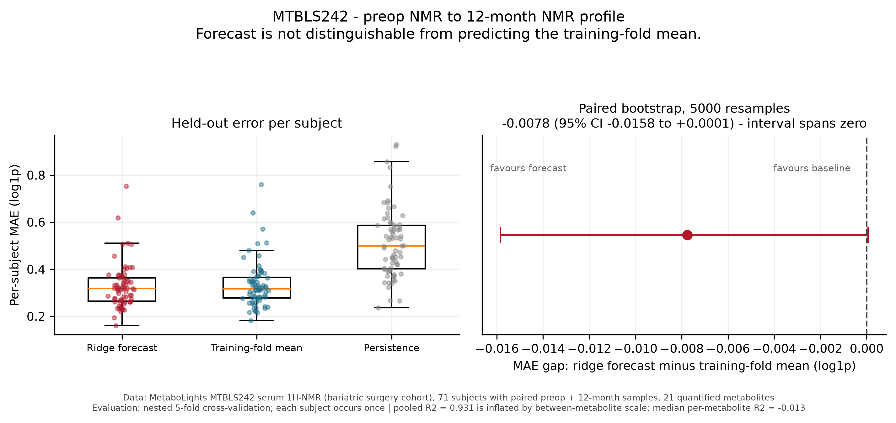

# Continuous forecast — results

Forecast the same subject's 12-month serum NMR profile from their pre-operative profile.
**71 subjects**, 21 metabolites, nested 5-fold cross-validation.

| Metric | Result |
|---|---:|
| Forecast MAE (log1p) | 0.326 |
| Training-fold mean baseline MAE | 0.334 |
| Persistence baseline MAE | 0.512 |
| **MAE gap vs mean baseline** | **−0.0078 (95% CI −0.0158 to +0.0001)** |
| **MAE gap vs persistence** | **−0.1847 (95% CI −0.2186 to −0.1519)** |
| Overall R² across all values | 0.931 |
| Median per-metabolite R² | −0.013 |

## Interpretation

**The forecast is not distinguishable from predicting the training-fold mean.** The 2.4%
MAE edge has a paired bootstrap interval that spans zero, so it cannot be separated from
noise at n=71. The earlier text described this improvement without an interval; the
interval is the honest version.

It *does* clearly beat a persistence baseline (predicting that the 12-month value equals
the pre-operative value), with an interval well clear of zero. That is a real finding,
but a modest one: it says the metabolome moves substantially over 12 months after
bariatric surgery, which is expected, not that we can forecast where any individual
lands.

**The pooled R² of 0.931 should not be quoted as forecasting performance.** It is driven
by scale differences *between* metabolites — predicting each metabolite's mean already
explains most of the pooled variance. The median per-metabolite R² is −0.013, i.e. at or
slightly below predicting the mean. Both numbers are reported together, and the figure
states the caveat on the plot.

Per-metabolite R² is in [`outputs/metabolite_metrics.csv`](outputs/metabolite_metrics.csv).
Only `L-leucine` (0.23), `creatinine` (0.17), and `L-valine` (0.12) rise meaningfully
above zero; `lipoproteins` sits at 0.057.

## Honest conclusion

Baseline NMR contains limited signal for the individual 12-month metabolite profile in
this small complete-case cohort. The pipeline is a valid proof of concept. Practical use
needs clinical covariates, treatment type, a larger cohort, and external validation.

See [`METHODS.md`](METHODS.md) for why each control exists, and
[`CORRECTION.md`](CORRECTION.md) for the retired responder claim.
