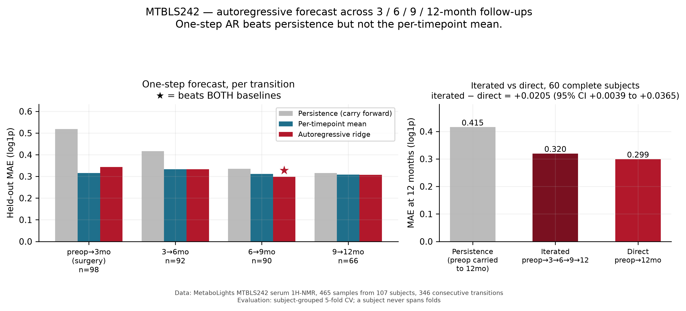

# Autoregressive forecast — results

Forecast each subject's NMR profile one step ahead across the full follow-up schedule,
using **every** time point rather than only preop and 12 months.

## Why this experiment exists

The pairwise experiments use 142 of the 465 samples. The 3, 6, and 9-month follow-ups
were discarded entirely. Using them gives roughly **five times more training data**:

| | Pairwise | Autoregressive |
|---|---:|---:|
| Samples used | 142 of 465 | **465 of 465** |
| Subjects | 71 | **107** |
| Training examples | 71 pairs | **346 transitions** |
| Complete 5-point trajectories | — | **60 subjects** |

Transitions per step: preop→3mo **98**, 3→6mo **92**, 6→9mo **90**, 9→12mo **66**.

Only *consecutive* transitions are used. A subject missing the 6-month sample does not
contribute a manufactured 3→9 jump — a two-step gap is a different forecasting problem,
and pooling it would silently mix horizons.

## Evaluation

**Subject-grouped 5-fold CV.** One subject contributes up to four transitions, so
splitting rows at random would put the same person in train and test. Groups are whole
subjects — the same leakage guard the Bridge MTBLS1 experiment needed.

**Persistence is the baseline that matters.** Over a three-month gap a profile barely
moves, so carrying the last observation forward is a strong comparator. The
per-timepoint mean is reported too, and it is computed per transition: "the average
6-month profile" is not the same target as "the average 12-month profile".

Ridge penalty is selected inside each training fold. The grid runs to 1e5 — an earlier
grid capped at 100 selected 100 in every fold, and a hyperparameter pinned at the
boundary means the grid is choosing rather than the data. Extending it confirmed 100 is
a genuine interior optimum.

## Results

| Metric | Result |
|---|---:|
| Autoregressive ridge MAE | **0.322** |
| Persistence MAE | 0.405 |
| Per-timepoint mean MAE | 0.318 |
| **vs persistence** | **−0.083 (95% CI −0.099 to −0.068)** |
| **vs per-timepoint mean** | **+0.004 (95% CI −0.003 to +0.011)** |



### Verdict

**One-step AR beats persistence but not the per-timepoint mean.**

Knowing a subject's own profile at time *t* does not beat simply knowing what the cohort
looks like at time *t+1*. The five-fold increase in training data did not change the
conclusion the pairwise experiments reached.

### Per transition — where the signal actually is

| Transition | n | Model | Persistence | Mean | Beats persistence | Beats mean |
|---|---:|---:|---:|---:|:---:|:---:|
| preop→3mo (surgery) | 98 | 0.344 | 0.518 | 0.316 | ✓ | ✗ |
| 3→6mo | 92 | 0.334 | 0.416 | 0.333 | ✓ | ✗ |
| **6→9mo** | 90 | **0.298** | 0.335 | 0.311 | **✓** | **✓** |
| 9→12mo | 66 | 0.308 | 0.316 | 0.309 | ✗ | ✗ |

This is the one genuinely new finding in the repo, and it is only visible because the
mid time points were used:

- **preop→3mo:** persistence collapses (0.518) — surgery moves the metabolome hard. But
  the mean wins, because everyone converges toward a similar post-surgical profile. The
  individual's starting point stops mattering.
- **3→6mo:** the model and the mean are indistinguishable.
- **6→9mo:** the **only** window where a subject's own profile carries forecastable
  information — the model beats both baselines here.
- **9→12mo:** everything has plateaued. Persistence, the mean, and the model are within
  0.008 of each other; nothing beats anything.

Read carefully: this is a single window out of four, at n=90, without correction for
having looked at four transitions. It is a hypothesis worth testing in another cohort,
**not** an established result.

## Iterated vs direct

Rolling the one-step model forward four times (preop→3→6→9→12) and scoring at 12 months,
against the direct preop→12mo ridge, on the same 60 complete subjects:

| Approach | MAE at 12 months |
|---|---:|
| Persistence (preop carried to 12mo) | 0.415 |
| Iterated preop→3→6→9→12 | 0.320 |
| **Direct preop→12mo** | **0.299** |

**Iterated − direct = +0.021 (95% CI +0.004 to +0.037).** The interval excludes zero, so
walking the trajectory is *reliably worse* than jumping straight to the end. Error
compounds across four steps, and each step's shrinkage pulls the forecast further toward
the mean.

If you want the 12-month profile, forecast it directly. The trajectory is worth modelling
for what it says about *when* the metabolome settles, not as a route to a better
endpoint forecast.

## Limitations

- Still metabolites forecasting metabolites. No clinical outcome exists in MTBLS242's
  public metadata, so this says nothing about weight loss or remission.
- The 6→9mo result is one window of four, uncorrected for multiplicity.
- Artifact quarantine matters more here than anywhere else: `isopropanol` is a surgical
  skin-prep contaminant present at preop and not afterwards, so in a pooled AR model it
  encodes "this is the preop→3mo transition" rather than biology. It is excluded by
  default; `--include-artifacts` restores it.
- A single pooled transition model is fitted across all four steps. Per-transition models
  would be more flexible but would cut each to ~90 examples.

## Reproduce

```bash
python forecast_autoregressive.py
python figures.py
```
