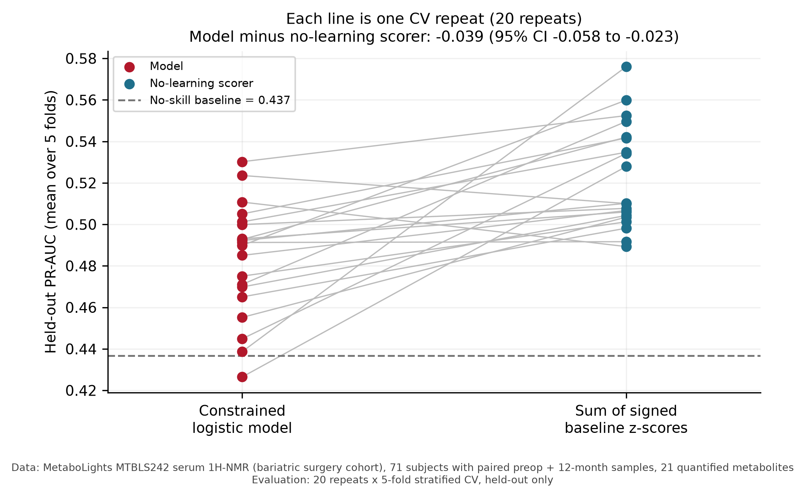

# Responder forecast — results

> **This supersedes an earlier result of PR-AUC 0.671 ("1.54× lift").** That claim has
> been withdrawn; see [`CORRECTION.md`](CORRECTION.md) for what was wrong and how to
> reproduce both numbers.

## Question

Can the pre-operative serum ¹H-NMR profile forecast which patients will show a strong
metabolic response 12 months after bariatric surgery?

**Response** means at least **6 of 11** literature-directed obesity markers improve
*more than their own baseline predicts* — change residualized on baseline, fitted inside
each training fold. Raw change would not work: it is anti-correlated with its own
baseline at a median of −0.62, so it would mostly measure regression to the mean.

## Setup

| | |
|---|---|
| Cohort | MetaboLights **MTBLS242**, serum ¹H-NMR, bariatric surgery |
| Subjects | **71** with paired pre-operative + 12-month samples |
| Responders | **31 (43.7%)** |
| Features | **18** metabolites (3 exogenous artifacts quarantined) |
| Model | Sign-constrained logistic regression, L-BFGS-B, 8 ↑ / 3 ↓ / 7 free |
| Evaluation | **20 repeats × 5-fold** stratified CV, held-out subjects only |
| Metric | PR-AUC (average precision) |

## Results

| Metric | Result |
|---|---:|
| Model PR-AUC | **0.483 ± 0.027** |
| No-skill baseline (prevalence) | 0.437 |
| Observed lift | 1.11× |
| **No-learning scorer** | **0.522** |
| Model − no-learning scorer | **−0.039** (95% CI −0.058 to −0.023) |
| Pairing-destroyed null, median lift | 1.04× |
| Pairing-destroyed null, 95th percentile | 1.24× |
| Permutation p-value | 0.894 |
| Solver convergence | 100% |

### Verdict

**No evidence of forecasting skill beyond regression to the mean.**

Three independent controls agree:

1. The observed 1.11× lift sits **inside** the distribution a no-signal null reaches
   (median 1.04×, 95th percentile 1.24×). It does not clear it.
2. The trained model is **worse** than summing signed baseline z-scores, with a
   confidence interval that excludes zero. Eighteen features fitted on 57 training
   subjects overfits relative to a fixed-weight sum.
3. Permutation p = 0.894.




### Constraints that bind

**8 of 11** literature constraints are binding — the coefficient is pinned at exactly
0.0 because this cohort pulls the opposite way: `L-valine`, `L-leucine`,
`L-allo-Isoleucine`, `D-phenylalanine`, `L-alanine`, `lipoproteins`, `L-glutamine`,
`histidine`.

This is interpretable only because the solver converges. Directions established for
obesity *status* largely do not transfer to forecasting 12-month *change* here — which
is consistent with there being little signal to fit.

## What this does and does not mean

**Does not mean** pre-operative NMR cannot forecast metabolic response. It means this
cohort, at n=71, with this outcome, does not demonstrate that it does.

**Does not mean** anything about weight loss, obesity remission, or clinical events.
MTBLS242's public metadata contains no such outcome, so none was modelled.

**Does mean** the pipeline is sound and the controls work: the same machinery correctly
flags the retired claim as an artifact while confirming the continuous model genuinely
beats a persistence baseline.

## สรุปภาษาไทย

ผลเดิมที่รายงาน PR-AUC 0.671 (lift 1.54 เท่า) **ถูกถอนแล้ว** เพราะนิยาม outcome คำนวณจาก
ผลต่าง `12 เดือน − ก่อนผ่าตัด` ของเมตาโบไลต์ชุดเดียวกับที่ใช้เป็น feature ทำให้ค่า
correlation ระหว่าง baseline กับ change อยู่ที่ −0.62 โดยธรรมชาติของเลขคณิต ไม่ใช่ชีววิทยา
เมื่อทดสอบด้วย null ที่สลับคู่ผู้ป่วย (ทำให้ไม่มีสัญญาณจริงเหลืออยู่เลย) กลับได้คะแนน
**สูงกว่า** ข้อมูลจริง

ผลที่แก้ไขแล้ว: PR-AUC **0.483 ± 0.027** เทียบกับ baseline 0.437 (lift 1.11 เท่า) ซึ่ง
**อยู่ในช่วงของ null** และยัง**ต่ำกว่า**ตัวให้คะแนนแบบไม่เรียนรู้เลย (0.522) ค่า
permutation p = 0.894

**สรุป: ไม่มีหลักฐานว่า NMR ก่อนผ่าตัดพยากรณ์การตอบสนองได้เกินกว่าปรากฏการณ์
regression to the mean** ที่ n=71 — ไม่ได้แปลว่าพยากรณ์ไม่ได้ แต่แปลว่า cohort นี้ยัง
พิสูจน์ไม่ได้ ต้องใช้ cohort ที่ใหญ่กว่าและมี clinical outcome เชื่อมโยงระดับผู้ป่วย

## Reproduce

```bash
python -m pip install -r requirements.txt
python forecast_responder_pr_auc.py
python figures.py
python -m pytest tests/ -q
```
