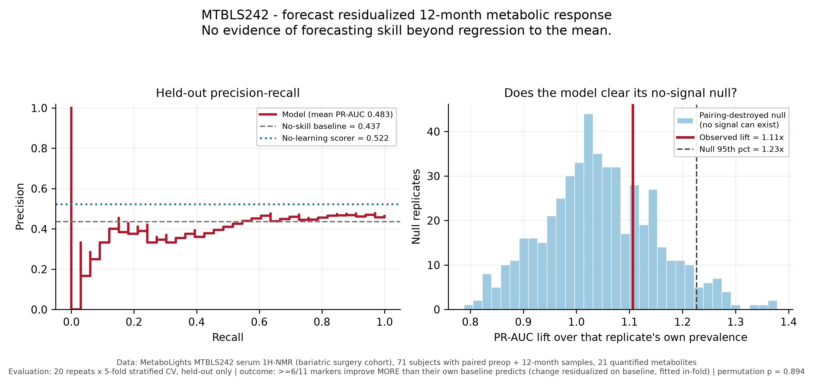

# Forecast — MTBLS242 12-month metabolic forecast

Can a pre-operative serum ¹H-NMR profile forecast what happens to a bariatric surgery
patient 12 months later?

**Short answer, on this cohort: no — and the interesting part is how we know.**

This repo forecasts the 12-month serum NMR profile of the same subject from their
pre-operative profile, on **71 MTBLS242 subjects** with both time points. It ships the
negative controls alongside every headline number, because the first version of this
analysis reported a result that its own controls do not support.

## Results

| Experiment | Result | Verdict |
|---|---|---|
| [Continuous](MTBLS242_forecast/RESULTS.md) — forecast the 12-month profile | MAE 0.326 vs 0.334 mean baseline, gap 95% CI **[−0.0158, +0.0001]** | Not distinguishable from predicting the mean. Does beat persistence. |
| [Responder](MTBLS242_forecast/RESULTS_PR_AUC.md) — forecast strong metabolic response | PR-AUC **0.483 ± 0.027** vs 0.437 prevalence; no-learning scorer **0.522** | **No evidence of skill beyond regression to the mean.** |



The red line is the observed result. The histogram is what a null in which *no
forecastable signal can exist* achieves. The line sits inside the histogram.

## A retracted claim

An earlier version reported **PR-AUC 0.671, a "1.54× lift"**, as evidence that
pre-operative NMR forecasts metabolic response. It has been withdrawn.

The outcome was defined as `12-month − pre-operative` on the same 11 metabolites used as
model inputs, so `corr(baseline, change)` was **−0.62** by arithmetic. When subject
pairing was destroyed — leaving no real signal by construction — the score went *up*, to
a median lift of 2.04× against the observed 1.57×. The model had also never converged;
its largest standardized coefficient was 0.018, and a scorer that fits nothing at all
reproduced its PR-AUC to three decimals.

A standard label-permutation test returns **p = 0.002** on that outcome and would have
waved it through. It holds the outcome fixed, so it structurally cannot detect an
outcome manufactured from the features.

Full write-up: [`CORRECTION.md`](MTBLS242_forecast/CORRECTION.md). Both numbers are
reproducible — the legacy path is still runnable.

## The controls

Each one exists because a specific failure was found here, not because it is
conventional. Details in [`METHODS.md`](MTBLS242_forecast/METHODS.md).

- **No-learning scorer** — a sum of signed, z-scored baseline markers. Catches a model
  that has not converged or has learned nothing. Every trained model is reported next to
  it.
- **Pairing-destroyed null** — shuffle which future belongs to which subject, then
  rebuild the outcome from scratch. Catches an outcome manufactured from the features.
  This is the one that mattered.
- **Label-permutation test** — necessary, and demonstrably not sufficient.
- **Paired bootstrap intervals** — on every model-versus-baseline gap, resampling
  subjects together.

## Run

```bash
python -m pip install -r MTBLS242_forecast/requirements.txt
cd MTBLS242_forecast

python forecast_mtbls242.py          # continuous 12-month profile forecast
python forecast_responder_pr_auc.py  # responder forecast + controls
python figures.py                    # regenerate Graph/ at 300 DPI
python make_deck.py --lang en        # English deck
python make_deck.py --lang th        # Thai deck
python -m pytest tests/ -q           # 42 tests
```

Reproduce the retired claim together with the controls that retired it:

```bash
python forecast_responder_pr_auc.py --legacy-outcome --include-artifacts \
    --output-dir outputs_legacy
```

The analysis scripts need only NumPy, pandas, and SciPy. matplotlib is needed for
`figures.py`, and python-pptx for `make_deck.py`.

A 13-slide walkthrough of the correction is available in
[English](MTBLS242_forecast/mtbls242_forecast_correction.pptx) and
[Thai](MTBLS242_forecast/mtbls242_forecast_correction_th.pptx). Both are built from the
same layout and the same summary JSONs, so neither can drift from the results or from
each other.

## Data

MetaboLights **MTBLS242** — bariatric surgery cohort, serum ¹H-NMR, 21 quantified
metabolites. The ISA-Tab sample sheet (`s_MTBLS242.txt`) and metabolite abundance table
(`m_MTBLS242_v2_maf.tsv`) are included, downloaded from the official EMBL-EBI
MetaboLights public directory, so the repo runs standalone.

Sample IDs encode a stable four-digit subject code, which is what makes a genuine
longitudinal pairing possible: 106 pre-operative and 71 twelve-month samples, **71
subjects with both**.

## Scope

This forecasts a **metabolite profile**, not a clinical outcome. MTBLS242's public
metadata contains no future disease incidence, BMI, or weight-loss target, so no claim
about weight loss, obesity remission, or clinical events is made or supported. The cohort
is bariatric surgery patients only, so it says nothing about outcomes without surgery or
about the general population.

## Credits

Pipeline and MTBLS242 forecast originally by
[Chaiporn2005/Forecast](https://github.com/Chaiporn2005/Forecast).

Literature-based monotonic constraints, the PR-AUC-over-ROC convention, the
provenance-on-every-figure convention, and the surgical skin-prep contamination finding
for isopropanol are carried over from the `Bridge_ai_summit_nmr_2026` metabolic screening
experiments (BDI Hackathon 2026, PhenoInsure).
